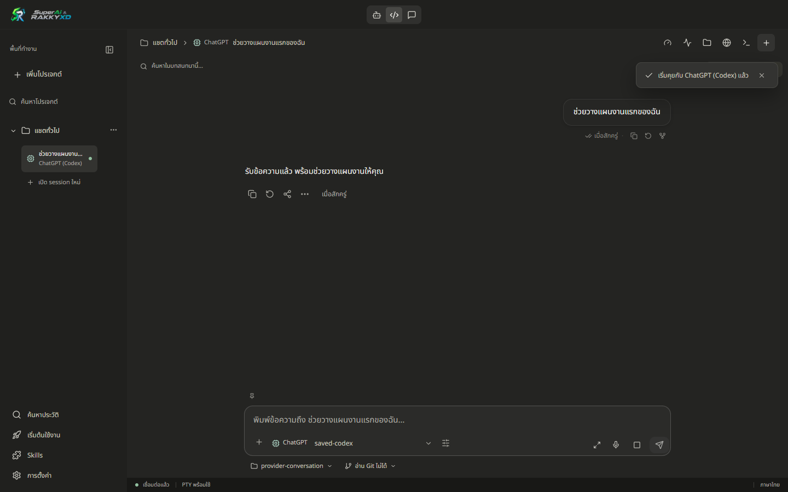
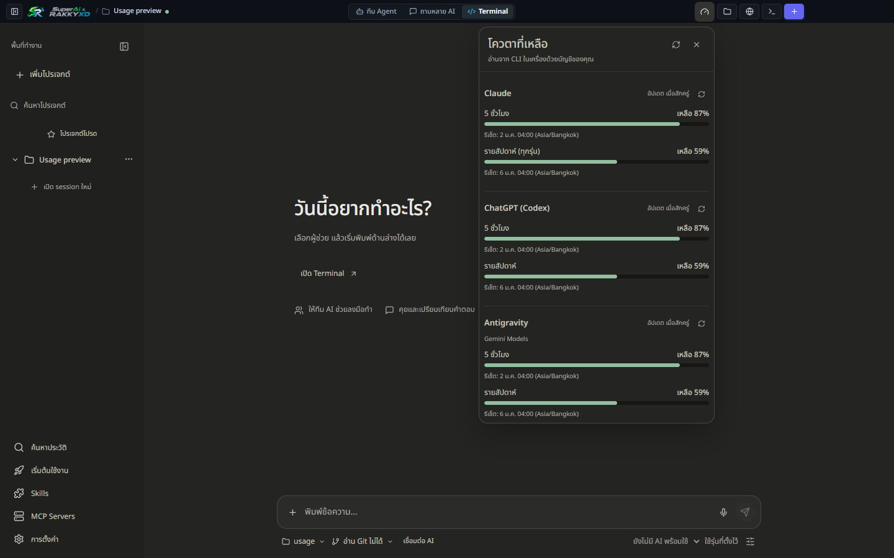

<p align="center">
  
</p>

<h1 align="center">SuperAi &amp; RAKKYXD</h1>

<p align="center">
  <a href="LICENSE"></a>
  <a href="https://nodejs.org"></a>
  <a href="https://github.com/rakgoorak/SuperAi-RAKKYXD/actions"></a>
  <a href="CONTRIBUTING.md"></a>
  <a href="https://github.com/rakgoorak/SuperAi-RAKKYXD-releases/releases/latest"></a>
</p>

<p align="center">
  <b>AI ทุกตัวของคุณ ในหน้าต่างเดียว — ดีไซน์ใหม่ Minimal เรียบหรู โฟกัสกับงาน</b><br />
  Claude · ChatGPT (Codex) · Antigravity · OpenCode · Freebuff<br />
  Windows และ macOS · ภาษาไทย · รันบนเครื่องคุณ 100% · ใช้บัญชี AI ของคุณเอง
</p>

<p align="center">
  <a href="https://github.com/rakgoorak/SuperAi-RAKKYXD-releases/releases/latest/download/SuperAi-RAKKYXD-Setup.exe"><b>⬇ ดาวน์โหลดสำหรับ Windows</b></a>
  &nbsp;·&nbsp;
  <a href="https://github.com/rakgoorak/SuperAi-RAKKYXD-releases/releases/latest/download/SuperAi-RAKKYXD-macos-arm64.dmg"><b>Mac (Apple Silicon)</b></a>
  &nbsp;·&nbsp;
  <a href="https://github.com/rakgoorak/SuperAi-RAKKYXD-releases/releases/latest/download/SuperAi-RAKKYXD-macos-x64.dmg"><b>Mac (Intel)</b></a>
</p>

<p align="center">
  
</p>

ถ้าคุณใช้ AI หลายตัวพร้อมกันแล้วต้องเปิดหลายโปรแกรมสลับไปมา **SuperAi & RAKKYXD** รวมทุกเครื่องมือไว้ในหน้าต่างเดียว: ให้ทีม AI ช่วยกันเขียนโค้ดและแก้งาน, เปิด CLI หลายเซสชันพร้อมกัน, ค้นหาประวัติแชตทุกค่าย, ควบคุม Git Worktrees คู่ขนาน และตรวจสอบโควตาคงเหลือของแต่ละเจ้าได้ทันที

---

## สารบัญ

- [ดาวน์โหลดและติดตั้ง](#ดาวน์โหลดและติดตั้ง)
- [ไฮไลต์การปรับปรุงดีไซน์ใหม่ (Minimal Interface)](#ไฮไลต์การปรับปรุงดีไซน์ใหม่-minimal-interface)
- [ฟีเจอร์เด่น](#ฟีเจอร์เด่น)
  - [1. สามโหมดการทำงาน (Agent, Code, Chat)](#1-สามโหมดการทำงาน-agent-code-chat)
  - [2. Quick Provider Chat & Safe Mode](#2-quick-provider-chat--safe-mode)
  - [3. ประวัติการสนทนารวมและค้นหาข้อความ (Unified History & Search)](#3-ประวัติการสนทนารวมและค้นหาข้อความ-unified-history--search)
  - [4. ซ่อนเซสชันโดยไม่ต้องลบ (Session Hide & Restore)](#4-ซ่อนเซสชันโดยไม่ต้องลบ-session-hide--restore)
  - [5. Git Worktrees & Branch Switcher ในตัว](#5-git-worktrees--branch-switcher-ในตัว)
  - [6. Ctrl + Click เปิด URL ทันที (เหมือน Claude App)](#6-ctrl--click-เปิด-url-ทันที-เหมือน-claude-app)
  - [7. Interactive Artifacts Preview](#7-interactive-artifacts-preview)
  - [8. พูดเพื่อพิมพ์ภาษาไทย (Local Whisper Thonburian)](#8-พูดเพื่อพิมพ์ภาษาไทย-local-whisper-thonburian)
  - [9. ดูโควตาคงเหลือ (Usage Tracker)](#9-ดูโควตาคงเหลือ-usage-tracker)
- [เริ่มใช้งานครั้งแรก](#เริ่มใช้งานครั้งแรก)
- [ระบบอัปเดตอัตโนมัติ](#ระบบอัปเดตอัตโนมัติ)
- [ความเป็นส่วนตัวและความปลอดภัย](#ความเป็นส่วนตัวและความปลอดภัย)
- [แก้ปัญหาที่พบบ่อย](#แก้ปัญหาที่พบบ่อย)
- [สำหรับนักพัฒนา](#สำหรับนักพัฒนา)

---

## ดาวน์โหลดและติดตั้ง

| แพลตฟอร์ม | ไฟล์ติดตั้ง | ขนาด | รูปแบบ |
| :--- | :--- | :--- | :--- |
| **Windows 10 / 11 (64-bit)** | [SuperAi-RAKKYXD-Setup.exe](https://github.com/rakgoorak/SuperAi-RAKKYXD-releases/releases/latest/download/SuperAi-RAKKYXD-Setup.exe) | ≈90 MB | ตัวติดตั้งอัตโนมัติ (NSIS) |
| **Mac Apple Silicon (M1/M2/M3/M4)** | [SuperAi-RAKKYXD-macos-arm64.dmg](https://github.com/rakgoorak/SuperAi-RAKKYXD-releases/releases/latest/download/SuperAi-RAKKYXD-macos-arm64.dmg) | ≈110 MB | Drag & Drop DMG |
| **Mac Intel** | [SuperAi-RAKKYXD-macos-x64.dmg](https://github.com/rakgoorak/SuperAi-RAKKYXD-releases/releases/latest/download/SuperAi-RAKKYXD-macos-x64.dmg) | ≈115 MB | Drag & Drop DMG |

- ไฟล์ทั้งหมดชี้ไปที่เวอร์ชันล่าสุดเสมอ ไม่จำเป็นต้องล็อกอิน GitHub
- มีไฟล์ ZIP แบบไม่ต้องติดตั้ง (Portable) ให้ดาวน์โหลดในหน้า [Releases](https://github.com/rakgoorak/SuperAi-RAKKYXD-releases/releases/latest)
- มีไฟล์ `.sha256` คู่กันทุกไฟล์สำหรับการตรวจสอบความถูกต้องของข้อมูล

---

## ไฮไลต์การปรับปรุงดีไซน์ใหม่ (Minimal Interface)

SuperAi & RAKKYXD ได้รับการปรับโฉมครั้งใหญ่สู่ **Warm Charcoal Minimal Interface**:
- **สวิตช์ 3 โหมดแบบ Compact 3-Icon Switch:** สลับระหว่างโหมด Agent, Code และ Chat ได้อย่างรวดเร็ว พร้อม Tooltips บอกฟังก์ชันชัดเจน
- **ลด Visual Clutter:** จัดโครงสร้างเส้นขอบและการ์ดให้เรียบแบน สบายตา คมชัด และไม่แย่งสมาธิจากการทำงานหลัก
- **Composer Options ปรับปรุงใหม่:** รวมการตั้งค่า Effort, สิทธิ์การเขียนไฟล์ และสถานะบัญชี AI ไว้ในจุดเดียว พร้อมรองรับการกด `Escape` เพื่อปิด
- **แถบเครื่องมือและไอคอน Flat Design:** ขนาดกะทัดรัด ประหยัดพื้นที่หน้าจอ เพิ่มพื้นที่มองโค้ดและการสนทนาให้กว้างขวางที่สุด

---

## ฟีเจอร์เด่น

### 1. สามโหมดการทำงาน (Agent, Code, Chat)

| โหมด | ลักษณะการใช้งาน | ความสามารถพิเศษ |
| :--- | :--- | :--- |
| **🤖 Agent** | สั่งงานโครงการใหญ่ ให้ทีม AI ช่วยกันวางแผนและรันงาน | Main Agent แจกจ่ายงานให้ Sub-agents (1–6 ตัว) ทำงานคู่ขนาน พร้อมสรุปผลงานเมื่อเสร็จสิ้น |
| **💻 Code** | หน้าต่าง Terminal & AI CLI แบบมัลติแท็บ | รัน Claude Code, Codex, Antigravity (`agy`), OpenCode, Freebuff หรือ Terminal ทั่วไป ส่งคำสั่งรวมได้ |
| **💬 Chat** | ถามคำถามเดียว ให้ AI หลายตัวช่วยกันตอบและสรุป | เปรียบเทียบมุมมองของ AI แต่ละค่าย พร้อมระบบ Synthesis รวมจุดเด่นและตัดจุดอ่อนออก |

### 2. Quick Provider Chat & Safe Mode
- เริ่มพิมพ์คำถามและคุยกับ AI ได้ทันทีตั้งแต่เปิดแอป โดยไม่ต้องสร้างโฟลเดอร์หรือตั้งค่าโปรเจกต์ก่อน
- มีโหมด **Safe Read-Only** อัตโนมัติเมื่อคุยทั่วไป ป้องกันไม่ให้ AI เผลอแก้ไขไฟล์สำคัญในเครื่องโดยไม่ตั้งใจ
- มีป้ายระบุตัวตนผู้ให้บริการ (**Provider Badges**) แสดงชัดเจนทั้งในแถบด้านข้าง แท็บเซสชัน และช่องพิมพ์คำสั่ง

### 3. ประวัติการสนทนารวมและค้นหาข้อความ (Unified History & Search)
- รวมประวัติการคุยของทุกเซสชันและทุก AI ไว้ในแผงประวัติเดียว
- รองรับการค้นหาข้อความแบบเจาะลึก (**Full-Text Search**) พิมพ์ค้นหาคำหรือโค้ดที่เคยคุยไว้ได้ทันที
- กรองดูเฉพาะ AI แต่ละค่ายได้ และคลิกเพื่อเปิดเซสชันเดิมกลับมาคุยต่อได้ทันที

### 4. ซ่อนเซสชันโดยไม่ต้องลบ (Session Hide & Restore)
- หากเปิดหลายเซสชันแล้วหน้าจอดูแน่น สามารถกดปุ่ม **ซ่อนเซสชัน (`EyeOff`)** บนหัวหน้าต่าง เพื่อพับเก็บเฉพาะเซสชันที่ไม่ใช้งานออกจากหน้าจอหลัก
- ประวัติการแชตและโปรเซสการทำงานของ AI ยังคงทำงานต่ออย่างสมบูรณ์ 100% ไม่ถูกตัดการเชื่อมต่อ
- กู้คืนกลับมาแสดงบนหน้าจอหลักได้ตลอดเวลาผ่านชิปด้านบน หรือคลิกจากแถบรายการเซสชันทางด้านซ้าย

### 5. Git Worktrees & Branch Switcher ในตัว
- สลับ Git Branch จริงของโปรเจกต์ได้โดยตรงจากแถบเหนือช่องพิมพ์คำสั่ง พร้อมระบบความปลอดภัย ป้องกันการสลับขณะ AI รันงาน
- สร้าง **Parallel Git Worktrees** เพื่อพัฒนาหลายฟีเจอร์แยกโฟลเดอร์คู่ขนานได้พร้อมกัน
- แถบ **Smart Merge Banner** ในหน้าต่างสรุปไฟล์ที่เปลี่ยน ช่วยตรวจสอบความถูกต้องและ Merge โค้ดกลับเข้าสู่ `main` พร้อมทำความสะอาด Worktree ได้ในคลิกเดียว

### 6. Ctrl + Click เปิด URL ทันที (เหมือน Claude App)
- ในช่องพิมพ์ข้อความ (Composer) หากมี URL สามารถกด **Ctrl + Click** (หรือ **Cmd + Click** บน Mac) บนลิงก์ เพื่อเปิดเว็บในเบราว์เซอร์หลักของระบบได้ทันที
- มีแถบ **🔗 Quick Link Chips** แสดงลิงก์ที่ตรวจพบใต้ช่องพิมพ์คำสั่ง ให้คลิกเปิดได้สะดวก
- ข้อความแชทของผู้ใช้ (Chat Bubbles) แปลง URL เป็นลิงก์ที่คลิกเปิดได้อัตโนมัติ

### 7. Interactive Artifacts Preview
- หน้าต่างพรีวิวโค้ดและผลงานแบบสด: HTML, SVG, Tailwind CSS, และไดอะแกรม Mermaid
- รองรับการทดสอบโค้ด React / JSX / TSX แบบอินเทอร์แอคทีฟบนเครื่องด้วย Local Runtime
- โหมดขยายดูเต็มจอ (Fullscreen) พร้อมการซูมและจัดขนาดไดอะแกรม

### 8. พูดเพื่อพิมพ์ภาษาไทย (Local Whisper Thonburian)
- กดปุ่มไมโครโฟนค้างไว้แล้วพูดภาษาไทยหรือภาษาอังกฤษ
- ระบบแปลงเสียงเป็นข้อความด้วยโมเดล Whisper Thonburian บนเครื่อง 100% ปลอดภัย ข้อมูลเสียงไม่ถูกส่งออกภายนอก

### 9. ดูโควตาคงเหลือ (Usage Tracker)
- ตรวจสอบโควตาคงเหลือของ Claude, Codex, Antigravity แบบเรียลไทม์
- แสดงแถบสถานะและเวลารีเซ็ตโควตารอบ 5 ชั่วโมงและรอบสัปดาห์อย่างแม่นยำ ด้วยโทนสีเรียบหรูอ่านง่าย

<p align="center">
  
</p>

---

## เริ่มใช้งานครั้งแรก

เมื่อเปิดโปรแกรมครั้งแรก หน้าต่าง **เริ่มต้นใช้งาน (Setup Guide)** จะช่วยตรวจเช็กและติดตั้งสิ่งที่จำเป็นบนเครื่องให้อัตโนมัติ:

1. **Node.js 22 & Git** (ตรวจสอบและติดตั้งอัตโนมัติหากยังไม่มี)
2. **AI CLI ที่ต้องการใช้งาน:** เลือกล็อกอินตัวที่ต้องการ เช่น Claude Code, Codex, Antigravity (`agy`), OpenCode หรือ Freebuff
3. **เลือกโฟลเดอร์โปรเจกต์** หรือเริ่มคุยในโหมด Quick Chat ทั่วไปได้ทันที
4. **Starter Skills (ตัวเลือกเสริม):** ให้ AI ช่วยแนะนำชุดคำสั่งพิเศษที่เหมาะสมกับโปรเจกต์ของคุณ

---

## ระบบอัปเดตอัตโนมัติ

โปรแกรมมีระบบตรวจเช็กอัปเดตอัตโนมัติในตัว โดยไม่ต้องดาวน์โหลดไฟล์มาติดตั้งใหม่ทุกรอบ:
- ตรวจสอบเวอร์ชันใหม่เมื่อเปิดโปรแกรมและทุก 30 นาที
- แจ้งเตือนผ่านการ์ดมุมล่างขวา พร้อมดาวน์โหลดเบื้องหลังและตรวจสอบ SHA-256 ก่อนอัปเดต
- เซสชันการทำงาน, ประวัติ และข้อมูลโปรเจกต์จะถูกเก็บไว้อย่างปลอดภัยและเปิดกลับมาคุยต่อได้ทันทีหลังอัปเดต

---

## ความเป็นส่วนตัวและความปลอดภัย

- **Local-First Architecture:** โปรแกรมรันบนเครื่องของคุณทั้งหมด ไม่มีเซิร์ฟเวอร์กลางคอยดักจับข้อมูล
- **รันผ่านบัญชีของคุณเอง:** การเชื่อมต่อ AI ทุกตัวทำงานผ่าน CLI ด้วย Session และ API Key ของคุณเอง
- **ข้อมูลโปรเจกต์:** ข้อมูลการตั้งค่าและประวัติแชตจัดเก็บอยู่ในเครื่องที่ `%USERPROFILE%\.opencode-multi` (Windows) หรือ `~/.opencode-multi` (macOS)
- **ปลอดภัยเมื่อแชร์โค้ด:** ไฟล์แนบจะถูกแยกเก็บไว้ในโฟลเดอร์ `.superai/attachments/` ภายในโปรเจกต์ (แนะนำให้ใส่ `.superai/` ใน `.gitignore`)

---

## แก้ปัญหาที่พบบ่อย

| อาการ | วิธีแก้ไข |
| :--- | :--- |
| **Windows ขึ้น “Windows protected your PC”** | คลิก **More info** แล้วเลือก **Run anyway** (โปรแกรมยังไม่มีใบรับรองดิจิทัลแบบชำระเงิน) |
| **macOS แจ้งเตือนว่าเปิดแอปไม่ได้** | ไปที่ **System Settings → Privacy & Security** แล้วคลิก **Open Anyway** |
| **AI แจ้งว่า Model ไม่รองรับบัญชี** | กดปุ่ม Composer Options เพื่อเปลี่ยน Model หรือปล่อยว่างเพื่อใช้ค่าเริ่มต้นของ CLI |
| **หน้าต่าง Usage ไม่ขึ้นข้อมูล** | ใช้งาน CLI ตัวนั้นอย่างน้อยหนึ่งครั้ง แล้วกดปุ่ม Refresh ในหน้าต่าง Usage |
| **สลับ Git Branch ไม่ได้** | ตรวจสอบว่าไม่มี AI กำลังรันงานอยู่ และไม่มีไฟล์ Uncommitted ในโฟลเดอร์ |

---

## สำหรับนักพัฒนา

### ความต้องการของระบบ
- Node.js 22 ขึ้นไป
- Git for Windows / macOS

### การติดตั้งและพัฒนา
```bash
# ติดตั้ง dependencies
npm install

# Build ทุกแพ็กเกจ
npm run build

# เปิดแอปพลิเคชัน
npm start

# รันชุดการทดสอบทั้งหมด
npm test
npm run test:provider-conversation
npm run test:conversation-ui
```

### โครงสร้างแพ็กเกจ
```
AgentBuild/
├── packages/
│   ├── core/              # โมดูลแกนกลาง Agent, Providers และ Tools
│   ├── studio/
│   │   ├── server/        # Express, WebSocket, node-pty, CLI Managers
│   │   └── client/        # Minimal UI (React, Vite, Tailwind, Lucide)
│   └── desktop/           # Electron Shell, Updater, File Previews, Native Tests
├── installer/             # NSIS Installer Script & DMG Assets
└── scripts/               # Build, Package & Release Scripts
```

---

## การมีส่วนร่วม (Contributing)

ยินดีต้อนรับการมีส่วนร่วมจากนักพัฒนาทุกคน! สามารถอ่านรายละเอียดเพิ่มเติมเกี่ยวกับแนวทางการส่ง Pull Request, การแจ้งบั๊ก, และ Code of Conduct ได้ที่ [CONTRIBUTING.md](CONTRIBUTING.md)

---

## ความปลอดภัย (Security)

หากพบช่องโหว่ด้านความปลอดภัย โปรดอ่านนโยบายการรายงานช่องโหว่อย่างปลอดภัยได้ที่ [SECURITY.md](SECURITY.md)

---

## ข้อจำกัดความรับผิดชอบ (Disclaimer)

- **SuperAi & RAKKYXD** เป็นซอฟต์แวร์เครื่องมือ Desktop Workspace ที่อำนวยความสะดวกในการสั่งการ AI Agent และ CLI บนเครื่องคอมพิวเตอร์ของคุณ
- โค้ด คำสั่ง shell หรือการเปลี่ยนแปลงไฟล์ที่สร้างขึ้นโดย AI จะถูกรันบนสภาพแวดล้อมเครื่องของคุณตามสิทธิ์ที่คุณอนุญาต ผู้ใช้ควรตรวจสอบคำสั่งก่อนให้ Agent ดำเนินการ
- การใช้งานโมเดล AI แต่ละค่ายอยู่ภายใต้ข้อกำหนดการให้บริการ (Terms of Service) และนโยบายราคาของผู้ให้บริการนั้นๆ

---

## สัญญาอนุญาต (License)

ซอฟต์แวร์นี้เผยแพร่ภายใต้สัญญาอนุญาตแบบ [MIT License](LICENSE) &copy; 2026 RAKKYXD &amp; SuperAi Contributors.

---

<p align="center">
  พัฒนาด้วยความใส่ใจเพื่อประสบการณ์การพัฒนาซอฟต์แวร์ด้วย AI ที่คล่องตัวและทรงพลังที่สุด<br />
  <b>SuperAi &amp; RAKKYXD Team</b>
</p>
