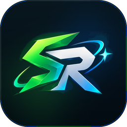
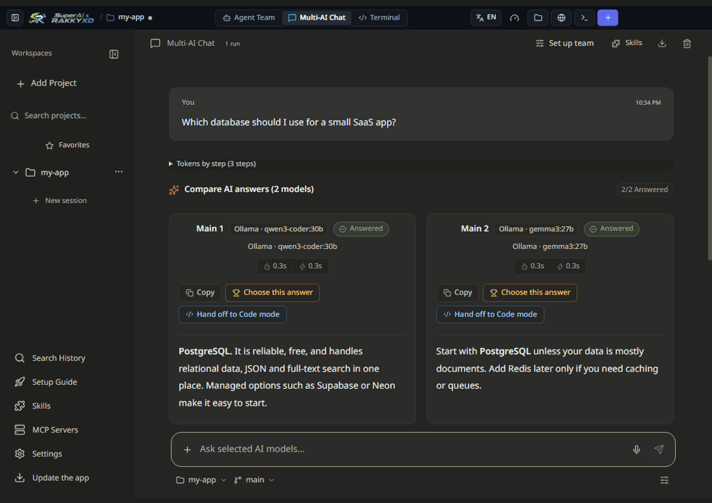
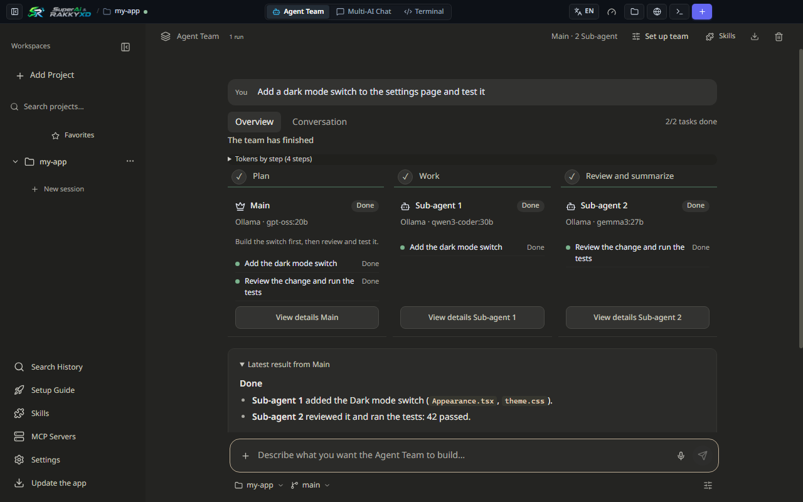
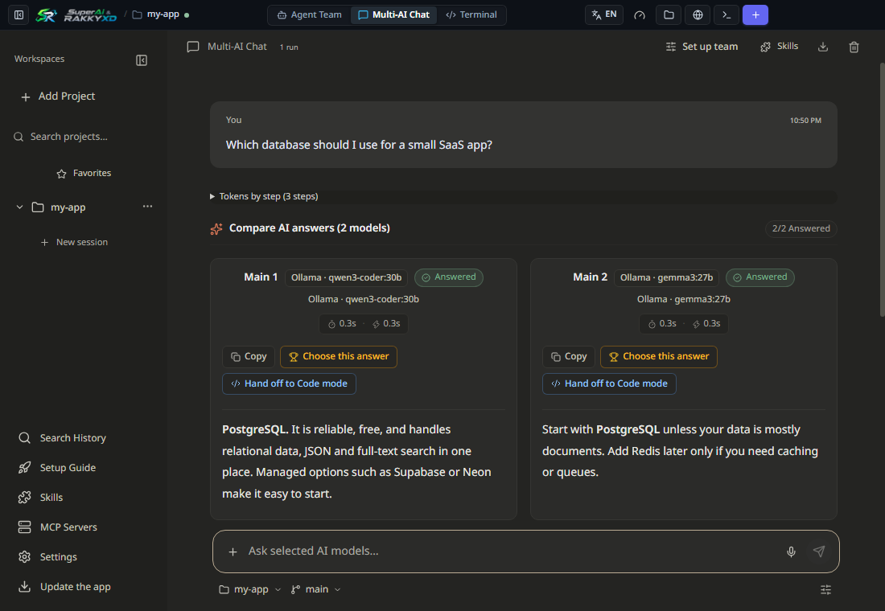
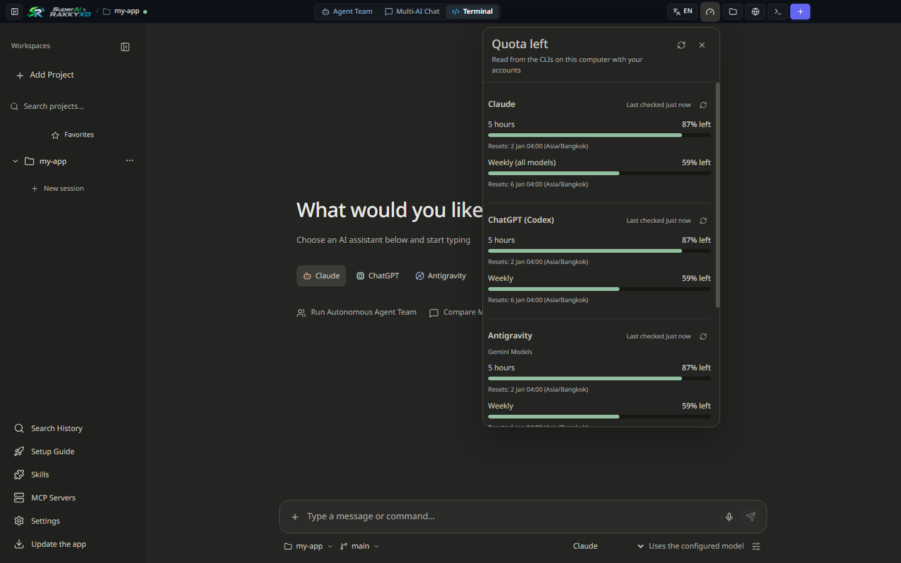

  

<h1 align="center">SuperAi &amp; RAKKYXD</h1>

  <strong>One desktop workspace for the AI coding tools you already use.</strong> 
  Work with Agent, Code and Chat modes across Windows and macOS.

  
  
  
  
  

  <a href="https://rakgoorak.github.io/SuperAi-RAKKYXD/"><strong>Website</strong></a> ·
  <a href="https://github.com/rakgoorak/SuperAi-RAKKYXD-releases/releases/latest"><strong>Download</strong></a> ·
  <a href="PRIVACY.md">Privacy</a> ·
  <a href="SECURITY.md">Security</a> ·
  <a href="README_TH.md">ภาษาไทย</a>

  

## What it is

SuperAi &amp; RAKKYXD is an open-source desktop workspace for people who work across several AI coding assistants. It brings provider sessions, project folders, terminals and previews together so you can choose the right workflow without juggling separate app windows.

It supports Claude Code, Codex, Antigravity (<code>agy</code>), OpenCode, Freebuff and local Ollama. Provider availability depends on the CLI and account you install. Freebuff is available in Code mode.

## Three ways to work

| Mode | Use it for | How it works |
| :--- | :--- | :--- |
| **Agent** | Delegating a larger project task | A Main Agent plans, asks when requirements are unclear, and can assign work to 1–6 sub-agents. File edits are an explicit choice. |
| **Code** | Working across CLI and terminal sessions | Open multiple sessions for a project and choose the provider, model and effort for each one. |
| **Chat** | Comparing several AI answers | Send a prompt to 1–5 Main Agents, compare attributed responses, then optionally ask for a synthesis. |

  
  

  

## Tools around the conversation

- Search and reopen conversations across providers, or rewind project files to before any message with **Checkpoints**.
- Review AI file changes section by section (keep or undo each hunk) and create **Git worktrees** for parallel branches.
- Render full Markdown, math (**KaTeX**), **Mermaid** diagrams, inline videos and clickable file paths in chat, or preview HTML, SVG, Tailwind CSS and React artifacts beside your work.
- Let the AI use the built-in browser panel, Google Chrome / Microsoft Edge, or opt-in **Computer use** (screen view, clicks and typing with per-app permissions and a live Stop bar).

Chrome and Edge launched by Browser Use run in the background without opening a window by default. To sign in interactively or watch those browsers, start SuperAi with `SUPERAI_BROWSER_SHOW_WINDOW=1`. Both modes use the same SuperAi profiles. Use the built-in browser panel when you want to see the page inside SuperAi.

To use a browser window you already manage, start SuperAi with `SUPERAI_EDGE_CDP_PORT` or `SUPERAI_CHROME_CDP_PORT` set to the loopback DevTools port you explicitly enabled for that browser. This requires a running browser profile that permits DevTools connections. SuperAi does not turn on debugging or import logins. A normal window without an enabled port cannot be connected this way. Only enable the port for a profile you intend to share with automation.

Ask the agent to list tabs with `browser_tabs`, select the intended tab, and specify `browser: "edge"` or `browser: "chrome"` on subsequent calls. For attachments, use a file input ref from `browser_snapshot` with `browser_upload`. This also works with hidden file inputs that are already present in the page.
- Cut token consumption with the one-click **Save tokens** switch, queue your next message while the AI works, or open **Quick Ask** from anywhere with a global shortcut.
- Dictate with local Whisper and review the transcript before sending.
- Check provider usage and quota information, use multiple accounts, and connect optional API providers (OpenRouter, DeepSeek, Groq or custom OpenAI-compatible endpoints).
- Browse and install skills with confirmation, or paste `mcpServers` JSON across several AIs at once.
- Use the installer and workspace in **English, Thai, Japanese or Chinese**.

## Download

Choose the latest installer for your computer:

| Platform | Download |
| :--- | :--- |
| Windows 10 / 11 (64-bit) | [Windows installer](https://github.com/rakgoorak/SuperAi-RAKKYXD-releases/releases/latest/download/SuperAi-RAKKYXD-Setup.exe) |
| macOS 13+ · Apple Silicon | [Apple Silicon DMG](https://github.com/rakgoorak/SuperAi-RAKKYXD-releases/releases/latest/download/SuperAi-RAKKYXD-macos-arm64.dmg) |
| macOS 13+ · Intel | [Intel DMG](https://github.com/rakgoorak/SuperAi-RAKKYXD-releases/releases/latest/download/SuperAi-RAKKYXD-macos-x64.dmg) |

Downloads do not require a GitHub account. Portable ZIP files and SHA-256 checksums are listed on the [latest release page](https://github.com/rakgoorak/SuperAi-RAKKYXD-releases/releases/latest).

**Security prompt:** Windows builds are not code-signed. macOS builds are signed with a consistent project certificate (so macOS permissions stay granted across updates) and are not Apple-notarized yet, so Windows SmartScreen or macOS Gatekeeper may ask you to confirm the app. Verify the SHA-256 checksum from the same release before opening it.

## First run

1. Install the app for Windows or macOS.
2. Follow the setup guide to check Node.js 22, Git and supported provider CLIs.
3. Sign in through the CLI for the provider you want to use.
4. Open a project folder, or start in Quick Chat.

## Privacy and security

The app does not operate an AI relay server. Prompts are handled by the provider or CLI you choose. Local Ollama models can run on your device. Provider privacy terms apply to prompts sent to that provider.

On first launch, the app asks before counting your computer as a user. Nothing is sent and no ID exists unless you allow it. When enabled, the anonymous usage count is sent every 10 minutes while the app is open and includes a random install ID, app version and operating system, with a two-letter country code from Cloudflare for aggregate online counts. The usage service does not store IP addresses, prompts, files, project names, accounts or API keys. Turning it off in **Settings → Notifications** deletes the ID.

Settings and conversation history are stored on your computer. Attachments are kept under <code>.superai/attachments/</code> inside the project; add <code>.superai/</code> to your <code>.gitignore</code> when needed.

Read the full [Privacy Policy](PRIVACY.md), [Security Policy](SECURITY.md) and [Third-party notices](THIRD_PARTY_NOTICES.md).

## Build from source

Requirements: Node.js 22+, Git, Windows 10/11 or macOS 13+.

    git clone https://github.com/rakgoorak/SuperAi-RAKKYXD.git
    cd SuperAi-RAKKYXD
    npm install
    npm run build
    npm start

Run the repository checks with:

    npm test

## Contributing

Read [CONTRIBUTING.md](CONTRIBUTING.md) and [CODE_OF_CONDUCT.md](CODE_OF_CONDUCT.md), then open an issue or pull request. Documentation, translations and provider adapters are good places to start.

## Independence and license

SuperAi &amp; RAKKYXD is an independent open-source project. It is not affiliated with, endorsed by or sponsored by Anthropic, OpenAI, Google or other AI providers. Their names and marks belong to their respective owners.

Released under the [MIT License](LICENSE).
