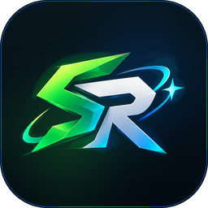
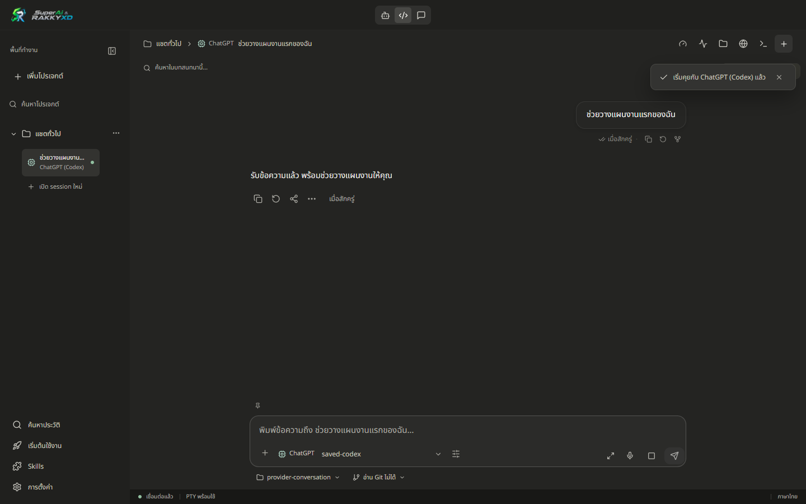
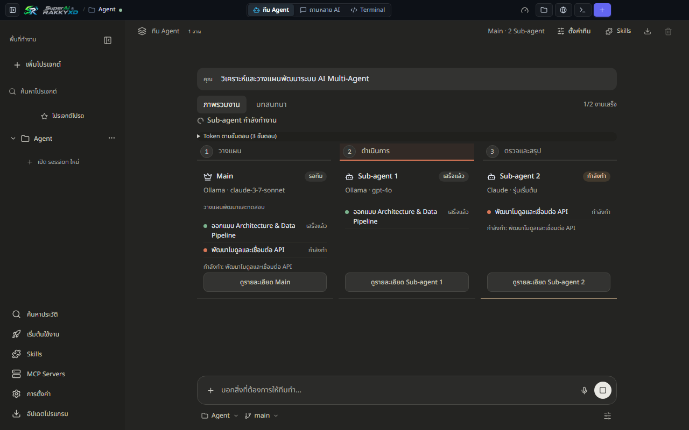
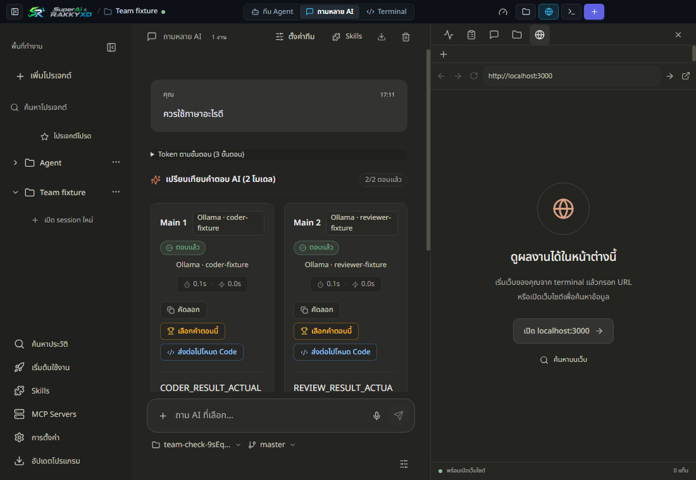
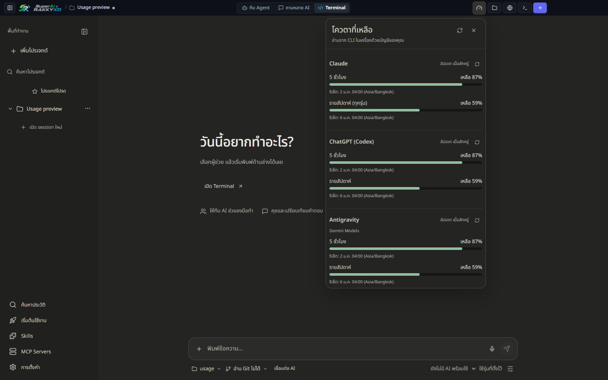

<p align="center">
  
</p>

<h1 align="center">SuperAi &amp; RAKKYXD</h1>

<p align="center">
  <a href="LICENSE"></a>
  <a href="https://nodejs.org"></a>
  <a href="https://github.com/rakgoorak/SuperAi-RAKKYXD/actions"></a>
  <a href="https://github.com/rakgoorak/SuperAi-RAKKYXD-releases/releases"></a>
  <a href="https://github.com/rakgoorak/SuperAi-RAKKYXD-releases/releases/latest"></a>
  <a href="https://rakgoorak.github.io/SuperAi-RAKKYXD-releases/"></a>
</p>

<p align="center">
  <a href="README.md">🇹🇭 ภาษาไทย</a> &nbsp;|&nbsp; <b>🇬🇧 English</b> &nbsp;|&nbsp; 🇯🇵 日本語 &nbsp;|&nbsp; 🇨🇳 简体中文
</p>

<p align="center">
  <b>All your AI coding assistants in a single, minimal, privacy-first desktop workspace.</b><br />
  Claude Code · ChatGPT (Codex) · Antigravity · OpenCode · Freebuff · Local Ollama<br />
  Windows & macOS · Multi-language (EN / TH / JA / ZH) · 100% Local-first · Bring Your Own Keys
</p>

<p align="center">
  <a href="https://github.com/rakgoorak/SuperAi-RAKKYXD-releases/releases/latest/download/SuperAi-RAKKYXD-Setup.exe"><b>⬇ Download for Windows (Setup.exe)</b></a>
  &nbsp;·&nbsp;
  <a href="https://github.com/rakgoorak/SuperAi-RAKKYXD-releases/releases/latest/download/SuperAi-RAKKYXD-macos-arm64.dmg"><b>Mac (Apple Silicon)</b></a>
  &nbsp;·&nbsp;
  <a href="https://github.com/rakgoorak/SuperAi-RAKKYXD-releases/releases/latest/download/SuperAi-RAKKYXD-macos-x64.dmg"><b>Mac (Intel)</b></a>
</p>

<p align="center">
  
</p>

<p align="center">
  
  
</p>

---

## The Problem
Modern software development with AI usually means keeping 5–10 browser tabs open (Claude, ChatGPT, Perplexity, Gemini), running separate terminal windows for coding CLIs, burning 4–6 GB of RAM, and losing track of context.

## The Solution
**SuperAi & RAKKYXD** is an open-source, lightweight desktop studio designed to orchestrate all your AI assistants under one sleek window:
- **Zero bloat**: Built with Electron + Vite + React with a minimal Warm Charcoal UI.
- **Privacy-first**: 100% local-first. No middleware, no analytics, no third-party telemetry. Your code and prompts communicate directly with the providers using your existing accounts and API keys.
- **Multi-Agent Orchestration**: Break down large architectural changes into parallel tasks handled by autonomous sub-agents.
- **Side-by-side Multi-AI Arena**: Ask one question, get responses from multiple models simultaneously, and synthesize the best solution.

---

## Downloads

| Platform | Installer | Size | Format |
| :--- | :--- | :--- | :--- |
| **Windows 10 / 11 (64-bit)** | [SuperAi-RAKKYXD-Setup.exe](https://github.com/rakgoorak/SuperAi-RAKKYXD-releases/releases/latest/download/SuperAi-RAKKYXD-Setup.exe) | ≈91 MB | Auto-installer (NSIS) |
| **macOS Apple Silicon (M1–M4)** | [SuperAi-RAKKYXD-macos-arm64.dmg](https://github.com/rakgoorak/SuperAi-RAKKYXD-releases/releases/latest/download/SuperAi-RAKKYXD-macos-arm64.dmg) | ≈110 MB | Drag & Drop DMG |
| **macOS Intel (x64)** | [SuperAi-RAKKYXD-macos-x64.dmg](https://github.com/rakgoorak/SuperAi-RAKKYXD-releases/releases/latest/download/SuperAi-RAKKYXD-macos-x64.dmg) | ≈115 MB | Drag & Drop DMG |

- Links always download the latest release (**v1.0.36**). No GitHub account required.
- Portable ZIP releases are available on the [Releases Page](https://github.com/rakgoorak/SuperAi-RAKKYXD-releases/releases/latest).
- SHA-256 checksums are provided for every asset.
- Live download statistics: [GitHub Releases Stats (Grev)](https://hanadigital.github.io/grev/?user=rakgoorak&repo=SuperAi-RAKKYXD-releases).

---

## Key Features

### 1. Three Specialized Working Modes
- **🤖 Agent Team**: Autonomous multi-agent coordination. The Main Agent plans, asks clarifying questions when requirements are ambiguous, delegates sub-tasks to 1–6 sub-agents running in parallel, and merges the final outcome.
- **💻 Terminal & Code**: Multi-tab AI CLI manager. Run Claude Code, Codex, Antigravity (`agy`), OpenCode, Freebuff, or system shells in split/tabbed layouts.
- **💬 Multi-AI Chat**: Send a single prompt to multiple AI models simultaneously. Compare viewpoints side-by-side with automatic synthesis.

### 2. Multi-Language Support (v1.0.36)
Switch interface languages instantly in **Settings → Language**:
- 🇬🇧 English
- 🇹🇭 ภาษาไทย (Thai)
- 🇯🇵 日本語 (Japanese)
- 🇨🇳 简体中文 (Simplified Chinese)

### 3. Local Thai & English Voice Dictation (Whisper)
Integrated offline speech-to-text powered by ONNX Runtime Web and Whisper models (including Thonburian Thai Whisper). Dictate prompts, code instructions, and commit messages hands-free.

### 4. Native Git Worktrees & Branch Switching
Work on separate features in parallel without stash collisions. Switch branches, isolate worktrees, and run independent agent tasks safely.

### 5. Multi-AI Quota & Usage Monitor
Live tracking for your 5-hour rolling windows, weekly caps, and token limits across Claude and ChatGPT.

<p align="center">
  
</p>

### 6. Interactive Artifacts Preview
Live HTML/React/SVG preview panel for rendered UI widgets, charts, and interactive components.

---

## Quick Start for Developers

```bash
# Clone the repository
git clone https://github.com/rakgoorak/SuperAi-RAKKYXD.git
cd SuperAi-RAKKYXD

# Install dependencies
npm install

# Run Desktop app in development mode
npm run dev

# Run full Electron application
npm start
```

### System Requirements
- Windows 10/11 (64-bit) or macOS 12+ (Apple Silicon / Intel)
- Node.js >= 22.0.0 (if building from source)
- Git installed on your system

---

## Security & Privacy Guarantee
- **100% on your machine**: No proprietary relay servers, no telemetry, no tracking.
- **Local Credentials**: Uses existing CLI sessions and local API keys stored safely on your filesystem.
- **Safe Mode**: Prompts before executing file-modifying tools or destructive shell commands.

---

## License
Distributed under the **MIT License**. See [`LICENSE`](LICENSE) for more information.
