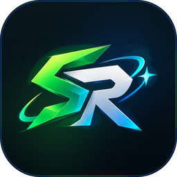
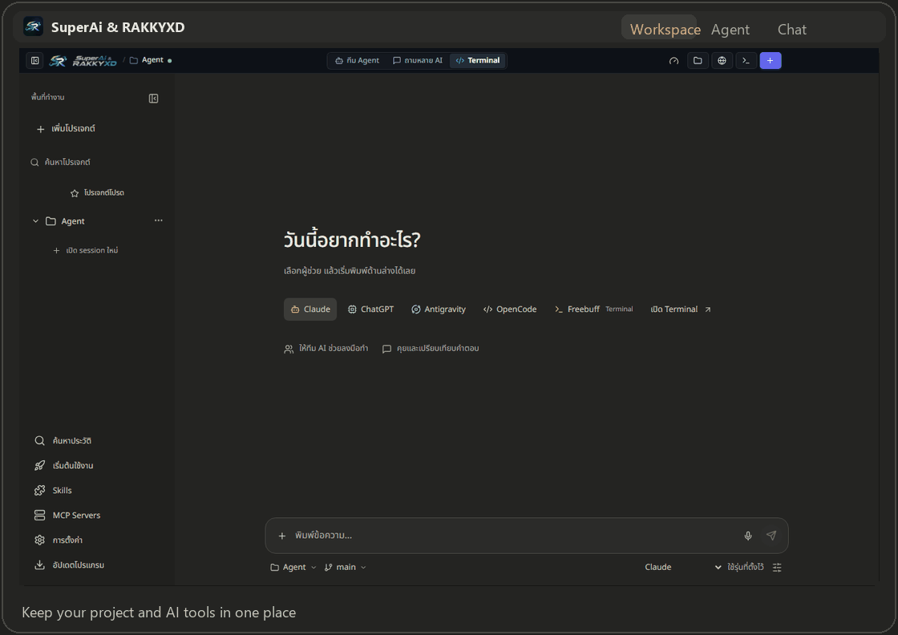
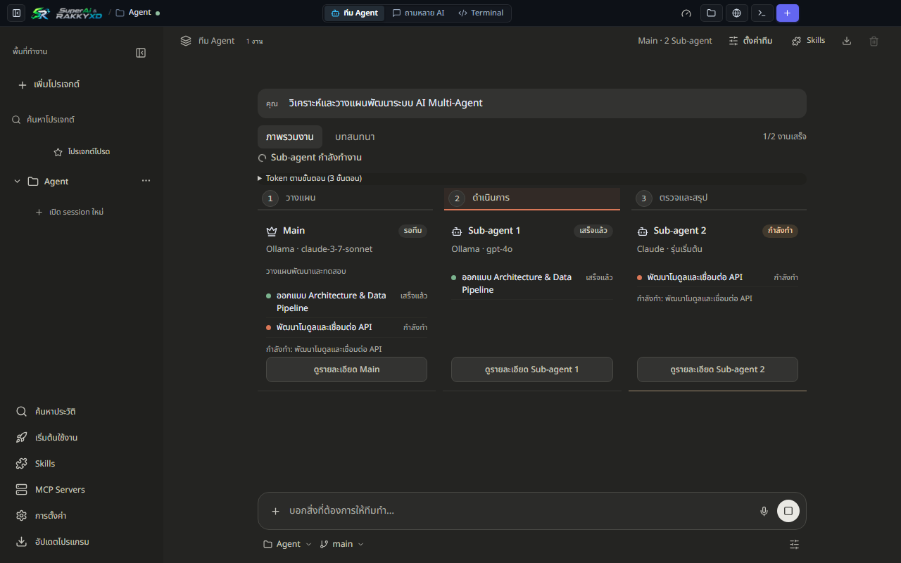
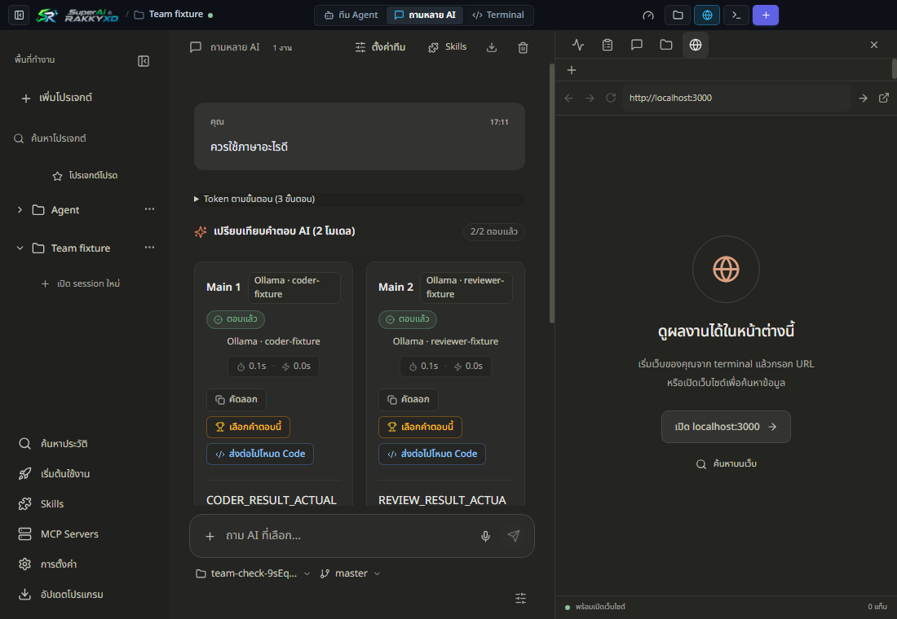
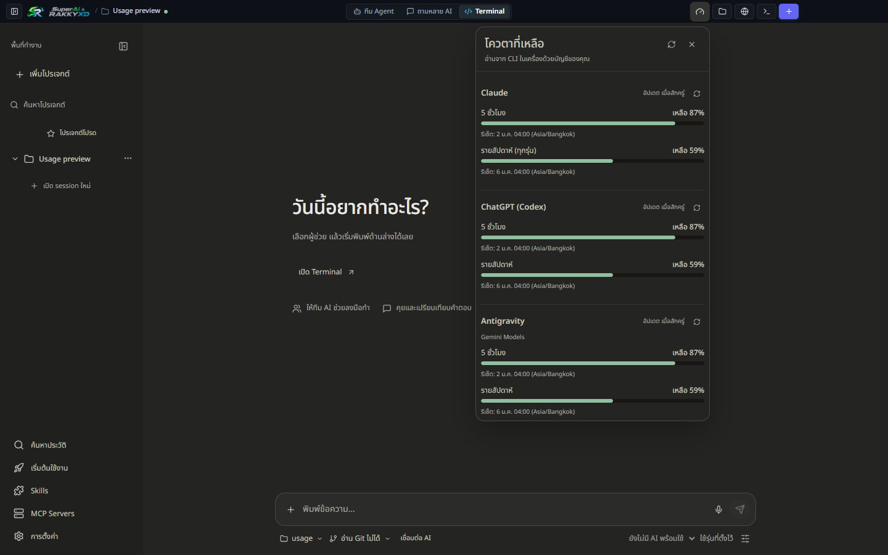

  

<h1 align="center">SuperAi &amp; RAKKYXD</h1>

  <strong>รวม AI coding tools ที่คุณใช้อยู่ไว้ใน workspace เดียว</strong> 
  ทำงานผ่านโหมด Agent, Code และ Chat บน Windows และ macOS

  
  
  
  
  

  <a href="https://rakgoorak.github.io/SuperAi-RAKKYXD/"><strong>เว็บไซต์</strong></a> ·
  <a href="https://github.com/rakgoorak/SuperAi-RAKKYXD-releases/releases/latest"><strong>ดาวน์โหลด</strong></a> ·
  <a href="PRIVACY.md">ความเป็นส่วนตัว</a> ·
  <a href="SECURITY.md">ความปลอดภัย</a> ·
  <a href="README.md">English</a>

  

## โปรแกรมนี้คืออะไร

SuperAi &amp; RAKKYXD เป็นโปรแกรม Desktop โอเพนซอร์สสำหรับคนที่ทำงานกับ AI coding assistants หลายตัว รวมเซสชัน โฟลเดอร์โปรเจกต์ เทอร์มินัล และพรีวิวไว้ในที่เดียว เพื่อเลือกวิธีทำงานให้เหมาะกับแต่ละงานได้โดยไม่ต้องสลับหลายหน้าต่าง

รองรับ Claude Code, Codex, Antigravity (<code>agy</code>), OpenCode, Freebuff และ Ollama ที่รันบนเครื่อง ความพร้อมใช้งานขึ้นอยู่กับ CLI และบัญชีที่ติดตั้ง โดย Freebuff ใช้ได้ในโหมด Code

## เลือกได้ 3 วิธีทำงาน

| โหมด | เหมาะกับงานแบบใด | วิธีทำงาน |
| :--- | :--- | :--- |
| **Agent** | แบ่งงานโปรเจกต์ขนาดใหญ่ | Main Agent วางแผน ถามเมื่อข้อกำหนดไม่ชัด และแบ่งงานให้ Sub-agents ได้ 1–6 ตัว การแก้ไฟล์เป็นตัวเลือกที่ต้องเปิดเอง |
| **Code** | ทำงานกับ CLI และเทอร์มินัลหลายเซสชัน | เปิดหลายเซสชันในโปรเจกต์เดียว แล้วเลือกผู้ให้บริการ โมเดล และระดับความคิดของแต่ละเซสชัน |
| **Chat** | เปรียบเทียบคำตอบจาก AI หลายตัว | ส่งพรอมป์ให้ Main Agent ได้ 1–5 ตัว ดูคำตอบพร้อมชื่อผู้ตอบ และขอให้สรุปรวมได้ |

  
  

  

## เครื่องมือที่อยู่ใกล้บทสนทนา

- ค้นหาและเปิดบทสนทนาจากผู้ให้บริการต่าง ๆ
- ซ่อนเซสชันโดยไม่หยุดงานที่กำลังทำอยู่
- สร้าง Git worktrees เพื่อแยก Branch ที่ทำงานคู่ขนาน
- พรีวิว HTML, SVG, Tailwind CSS, Mermaid และ React artifacts ที่รองรับ
- พูดภาษาไทยหรืออังกฤษด้วย Whisper บนเครื่อง แล้วตรวจข้อความก่อนส่ง
- ดูข้อมูลการใช้งานและโควตาเมื่อผู้ให้บริการมีข้อมูลให้
- เลือกวางแผนแบบอ่านอย่างเดียว หรืออนุญาตให้แก้ไฟล์เมื่อต้องการ
- ใช้หลายบัญชีที่รองรับและผู้ให้บริการ API ที่เลือกได้
- ค้นหาและติดตั้ง Skills โดยยืนยันก่อนติดตั้งแต่ละครั้ง

## ดาวน์โหลด

เลือกรุ่นล่าสุดสำหรับเครื่องของคุณ:

| แพลตฟอร์ม | ดาวน์โหลด |
| :--- | :--- |
| Windows 10 / 11 (64-bit) | [ตัวติดตั้ง Windows](https://github.com/rakgoorak/SuperAi-RAKKYXD-releases/releases/latest/download/SuperAi-RAKKYXD-Setup.exe) |
| macOS 11+ · Apple Silicon | [DMG สำหรับ Apple Silicon](https://github.com/rakgoorak/SuperAi-RAKKYXD-releases/releases/latest/download/SuperAi-RAKKYXD-macos-arm64.dmg) |
| macOS 11+ · Intel | [DMG สำหรับ Intel](https://github.com/rakgoorak/SuperAi-RAKKYXD-releases/releases/latest/download/SuperAi-RAKKYXD-macos-x64.dmg) |

ดาวน์โหลดได้โดยไม่ต้องล็อกอิน GitHub ส่วนไฟล์ ZIP แบบ Portable และ SHA-256 อยู่ในหน้า [Release ล่าสุด](https://github.com/rakgoorak/SuperAi-RAKKYXD-releases/releases/latest)

**คำเตือนความปลอดภัย:** โปรแกรม Windows ยังไม่ได้ลงนามดิจิทัล ส่วน macOS ใช้ ad-hoc signing และยังไม่ได้ notarize จึงอาจพบคำเตือนจาก Windows SmartScreen หรือ macOS Gatekeeper ควรตรวจ SHA-256 จาก Release เดียวกันก่อนเปิดไฟล์

## เริ่มใช้งานครั้งแรก

1. ติดตั้งโปรแกรมสำหรับ Windows หรือ macOS
2. ทำตามคู่มือเพื่อตรวจ Node.js 22, Git และ CLI ของผู้ให้บริการที่รองรับ
3. ล็อกอินผ่าน CLI ของผู้ให้บริการที่ต้องการ
4. เปิดโฟลเดอร์โปรเจกต์ หรือเริ่มจาก Quick Chat

## ความเป็นส่วนตัวและความปลอดภัย

แอปไม่มีเซิร์ฟเวอร์กลางสำหรับส่งคำขอ AI พรอมป์จะถูกจัดการโดยผู้ให้บริการหรือ CLI ที่คุณเลือก ส่วนโมเดล Ollama รันบนเครื่องได้ เงื่อนไขความเป็นส่วนตัวของผู้ให้บริการนั้นยังมีผลกับพรอมป์ที่ส่งไป

ระบบนับผู้ใช้แบบไม่ระบุตัวตนเป็นตัวเลือกและส่งทุก 10 นาทีขณะเปิดแอป โดยมีรหัสติดตั้งแบบสุ่ม เวอร์ชันแอป และระบบปฏิบัติการ Cloudflare ให้รหัสประเทศ 2 ตัวซึ่งเก็บไว้กับข้อมูลแบบไม่ระบุตัวตนเพื่อแสดงยอดออนไลน์รวม บริการนี้ไม่เก็บ IP พรอมป์ ไฟล์ ชื่อโปรเจกต์ บัญชี หรือ API key ปิดได้ที่ **การตั้งค่า → การแจ้งเตือน**

การตั้งค่าและประวัติสนทนาเก็บอยู่บนเครื่อง ไฟล์แนบอยู่ใน <code>.superai/attachments/</code> ภายในโปรเจกต์ และเพิ่ม <code>.superai/</code> ใน <code>.gitignore</code> ได้

อ่าน [นโยบายความเป็นส่วนตัว](PRIVACY.md), [นโยบายความปลอดภัย](SECURITY.md) และ [ประกาศซอฟต์แวร์จากบุคคลที่สาม](THIRD_PARTY_NOTICES.md)

## Build จาก Source

ต้องใช้ Node.js 22+, Git, Windows 10/11 หรือ macOS 11 ขึ้นไป

    git clone https://github.com/rakgoorak/SuperAi-RAKKYXD.git
    cd SuperAi-RAKKYXD
    npm install
    npm run build
    npm start

รันชุดตรวจสอบของโปรเจกต์ด้วย:

    npm test

## ร่วมพัฒนา

อ่าน [CONTRIBUTING.md](CONTRIBUTING.md) และ [CODE_OF_CONDUCT.md](CODE_OF_CONDUCT.md) แล้วเปิด Issue หรือ Pull Request งานเอกสาร คำแปล และ provider adapter เป็นจุดเริ่มต้นที่ดี

## โครงการอิสระและ License

SuperAi &amp; RAKKYXD เป็นโปรเจกต์โอเพนซอร์สอิสระ ไม่ได้เกี่ยวข้อง รับรอง หรือสนับสนุนโดย Anthropic, OpenAI, Google หรือผู้ให้บริการ AI รายอื่น ชื่อและเครื่องหมายการค้าเป็นของเจ้าของแต่ละราย

เผยแพร่ภายใต้ [MIT License](LICENSE)
