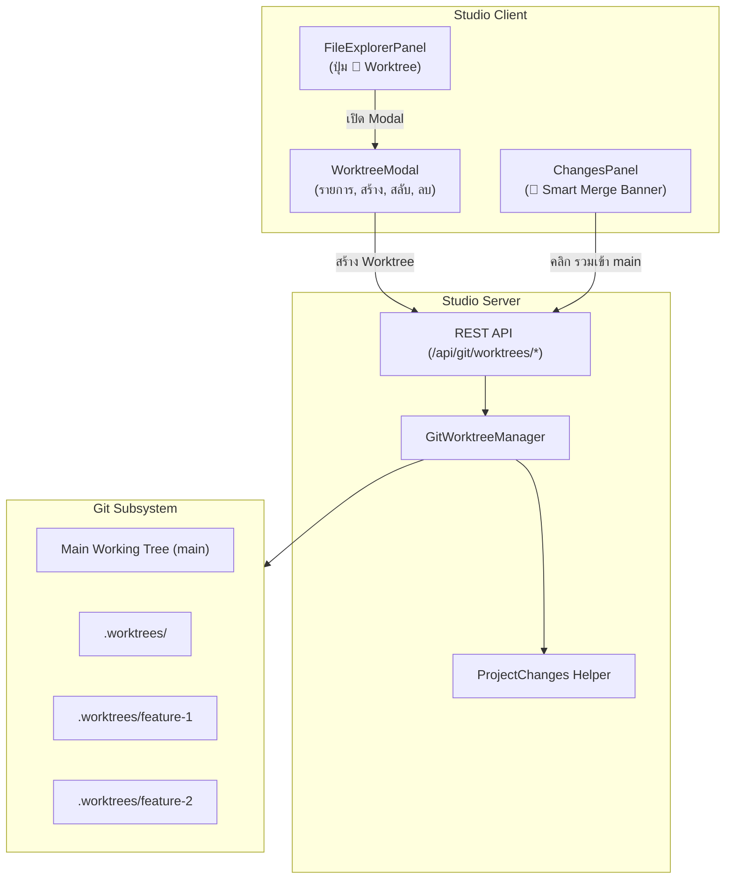

# Git Worktrees & One-Click Merge Architecture Design

## Goal
Provide a native, safe, and visual Git Worktree workflow within SuperAi & RAKKYXD. Enable developers to spin up isolated parallel coding workspaces on new Git branches without filesystem or edit collisions, and seamlessly merge completed work back into `main` with a single click and optional automated cleanup.

## Context & Motivation
When running multiple Code mode sessions (up to 6 sessions) in the same project directory, agents face severe race conditions:
- **Last-Write-Wins**: Concurrent edits to the same files lead to silent overwrites.
- **Git Lockouts**: Concurrent `git add` or `git commit` collide on `.git/index.lock`.
- **Merge Hell**: Unstaged and staged changes from multiple agents interleave in the working tree.

Git Worktrees solve this at the root by giving each session an isolated working directory backed by the same Git repository (`.git`).

---

## Architectural Components



---

## 1. Backend: Git Worktree Engine (`packages/studio/server/GitWorktrees.ts`)

### Functions & Interfaces
```ts
export interface WorktreeInfo {
  path: string;
  branch: string;
  commit: string;
  isMain: boolean;
  isCurrent: boolean;
  relativeDir: string;
}

export interface MergeWorktreeResult {
  success: boolean;
  commit?: string;
  deleted?: boolean;
  conflict?: boolean;
  conflictingFiles?: string[];
  error?: string;
}
```

1. **`listWorktrees(root: string): Promise<WorktreeInfo[]>`**
   - Runs `git worktree list --porcelain`.
   - Parses path, HEAD commit, branch (`refs/heads/<name>`), and flags (`bare`, `detached`).
   - Identifies `isMain` (first root) and `isCurrent` (matches `root`).
   - Computes human-friendly `relativeDir`.

2. **`createWorktree(root: string, branch: string): Promise<WorktreeInfo>`**
   - Validates branch name (blocks path traversal, control chars, special chars).
   - **Auto-Ignore Guard**: Inspects `.gitignore` at main project root; if `.worktrees` is not present, appends `.worktrees` to `.gitignore`.
   - Location: `.worktrees/<branch>`.
   - Executes `git worktree add "<dest>" -b "<branch>"`. If branch exists locally, executes `git worktree add "<dest>" "<branch>"`.
   - Returns created `WorktreeInfo`.

3. **`mergeWorktree(root: string, sourceBranch: string, targetBranch?: string, deleteAfter?: boolean): Promise<MergeWorktreeResult>`**
   - Resolves the main worktree root path.
   - Runs pre-merge conflict check in memory or via dry-run (`git merge-tree`).
   - If clean: executes `git merge --no-ff <sourceBranch> -m "Merge worktree branch '${sourceBranch}' into ${targetBranch}"`.
   - If `deleteAfter` is true:
     - Removes the worktree directory via `git worktree remove "<worktreePath>" --force`.
     - Deletes the merged branch via `git branch -d "<sourceBranch>"`.
   - If conflicts exist: identifies conflicting files and returns `{ success: false, conflict: true, conflictingFiles }` without leaving broken merge state.

4. **`removeWorktree(root: string, worktreePath: string, deleteBranch?: boolean): Promise<boolean>`**
   - Executes `git worktree remove "<worktreePath>" --force`.
   - If `deleteBranch`: executes `git branch -D "<branch>"`.

---

## 2. Server REST Endpoints (`StudioServer.ts`)

- `GET /api/git/worktrees`
  - Returns `{ worktrees: WorktreeInfo[], currentBranch: string, isWorktree: boolean }`
- `POST /api/git/worktrees`
  - Body: `{ branch: string }`
  - Creates the worktree and returns `WorktreeInfo`.
- `POST /api/git/worktrees/merge`
  - Body: `{ sourceBranch: string, targetBranch?: string, deleteAfter?: boolean }`
  - Merges into target branch (default `main`) and cleans up if requested.
- `DELETE /api/git/worktrees`
  - Body: `{ path: string, branch?: string, deleteBranch?: boolean }`
  - Removes the worktree.

---

## 3. Frontend UI (`packages/studio/client`)

### 3.1 Worktree Management Modal (`WorktreeModal.tsx`)
- Triggered by `🌿 Worktree` button in `FileExplorerPanel.tsx` and `ChangesPanel.tsx`.
- Displays:
  - Current active branch badge (`🌿 main` or `🌿 feature-xyz (Worktree)`).
  - Quick creation input: `[ ชื่อ Worktree เช่น feature-auth ]` + `[ + สร้าง Worktree ]`.
  - List of active worktrees with branch name, relative path, commit short hash, and action buttons (`สลับไปทำงาน`, `ลบ`).

### 3.2 Smart Merge Banner (`ChangesPanel.tsx`)
- Detects if the current active session is operating inside a worktree (`isWorktree: true`).
- Renders an alert card above the diff list:
  ```
  🌿 กำลังทำงานบน Worktree: feature-diff (แตกมาจาก main)
  ต้องการรวมการเปลี่ยนแปลงทั้งหมดเข้า main เลยไหม?
  [✓] ลบ Worktree หลังรวมเสร็จ     [✦ รวมโค้ดเข้า main ทันที (Merge)]
  ```
- Handles loading state during merge, success notification, and automatic refresh of file changes.

---

## 4. Safety & Security Guards
- **Strict Path Sandboxing**: Worktrees can only be created inside the project root (`.worktrees/`). No arbitrary filesystem paths allowed.
- **Gitignore Guarantee**: `.worktrees/` is automatically added to `.gitignore` to prevent recursive commits or accidental leaks.
- **Non-Destructive Conflict Handling**: Pre-checks merge conflicts before running real merges; aborts cleanly if conflicts arise, protecting working trees.
